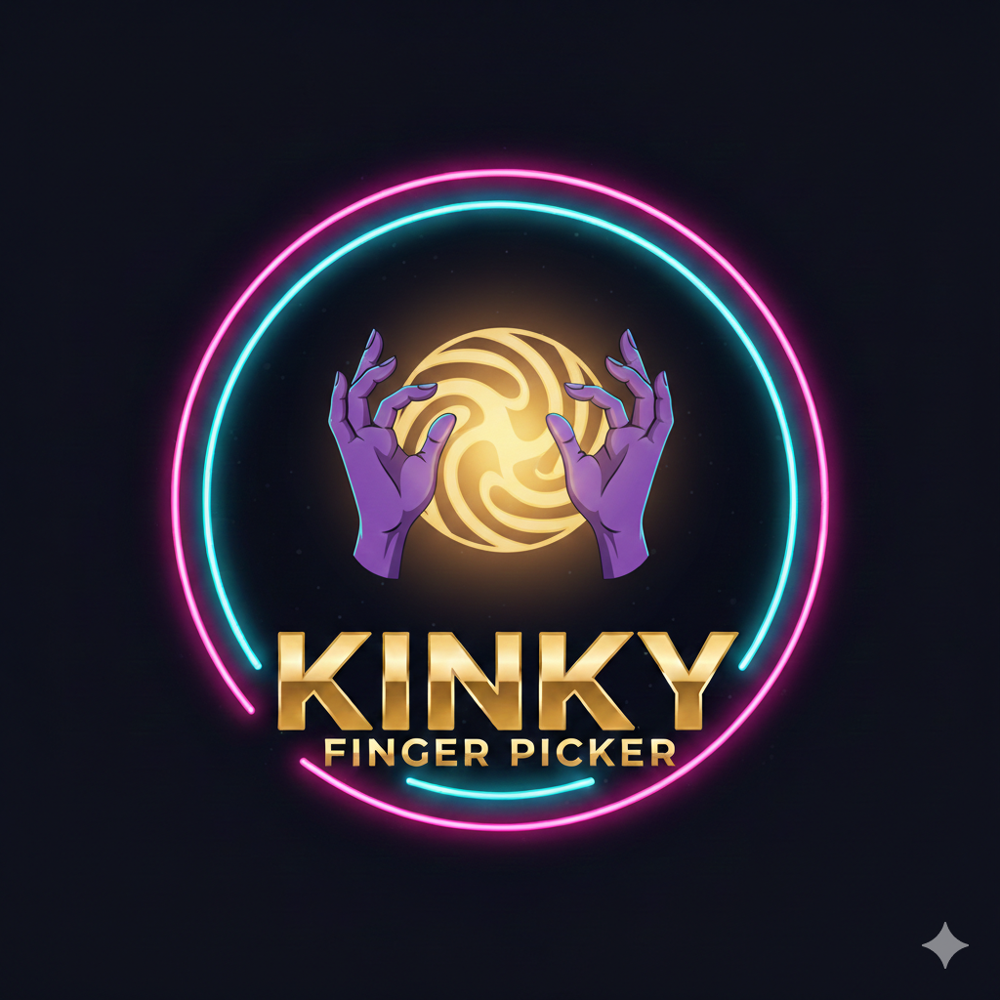

<div align="center">

  <!-- Logo -->
  

  <!-- Title -->
  <h1>🌶️ Kinky Finger Picker</h1>

  <!-- Tagline -->
  <p>El juego social definitivo para parejas y fiestas inolvidables</p>

  <!-- Badges -->
  [](https://opensource.org/licenses/MIT)
  [](https://reactnative.dev/)
  [](https://expo.dev/)
  [](https://www.typescriptlang.org/)
  [](https://github.com/andresmoralesc1/kinky-finger-picker/actions)
  [](https://github.com/andresmoralesc1/kinky-finger-picker)
  [](https://github.com/andresmoralesc1/kinky-finger-picker)

</div>

---

## ⚠️ Advertencia y Consentimiento

**Esta aplicación contiene contenido para adultos y está destinada exclusivamente a mayores de edad (+18).**
El respeto, la comunicación y el consentimiento mutuo son siempre la prioridad. ¡Juega responsablemente!

---

## 🎮 Acerca del Juego

**Kinky Finger Picker** es una experiencia multijugador interactiva que combina la selección táctil de dedos con retos y preguntas íntimas, picantes y atrevidas. Diseñada tanto para parejas como para grupos en fiestas y reuniones sociales.

### ✨ Características Principales

| Característica | Descripción |
|----------------|-------------|
| **🎯 Multitouch Real** | Motor táctil simultáneo de baja latencia para 2 a 10 jugadores en iOS, Android y Navegadores Web. |
| **💻 Modo Escritorio** | Simulación de toques con teclado (`1-5` para el lado izquierdo/mujeres, `6-0` para el lado derecho/hombres, `C` para limpiar) y clic con mouse. |
| **🔥 Interacción Dinámica** | Lógica de interacción donde los participantes de ambos lados de la pantalla interactúan entre sí. |
| **🎨 Estética Rojo & Blanco** | Diseño moderno con efecto glassmorphism, gradientes rojo pasión (`#E50914`, `#9B0014`) y tipografía blanca de alto contraste. |
| **🌶️ 3 Niveles de Intensidad** | Suave (*Mild*), Picante (*Spicy*) y Extremo (*Extreme*). |
| **🏳️‍🌈 Modos de Juego** | Hetero (pantalla dividida para interacción entre géneros), Gay y Lésbico. |
| **📊 Estadísticas y Logros** | Contador de rondas, niveles de XP, desbloqueo de medallas y desafíos diarios. |
| **💯 100% en Español** | Todas las preguntas, retos y textos de la interfaz adaptados de forma nativa en español. |

---

## 🚀 Inicio Rápido

### Prerrequisitos
- Node.js (v18 o superior)
- npm o pnpm

### Instalación
```bash
# Clonar el repositorio
git clone https://github.com/andresmoralesc1/kinky-finger-picker.git

# Entrar a la carpeta
cd kinky-finger-picker

# Instalar dependencias
npm install
```

### Ejecutar en Desarrollo

```bash
# Iniciar servidor Expo (Web / Móvil)
npm start

# O directamente en el navegador web
npm run web
```

---

## 🎯 ¿Cómo se Juega?

1. **Colocar los dedos:** Cada participante coloca un dedo sobre la pantalla táctil (o usa el teclado/mouse en PC).
2. **Conteo regresivo:** Se inicia un conteo sonoro y visual de 3 segundos mientras todos los dedos permanezcan en pantalla. Si alguien levanta el dedo antes de tiempo, el conteo se reinicia.
3. **Ruleta de selección:** La animación de ruleta gira y resalta a los jugadores seleccionados.
4. **Reto o Pregunta:** Se muestra la carta con el desafío adaptado a la interacción de los jugadores elegidos.
5. **Cumplir o Saltar:** Completa el reto o usa un comodín de salto limitado.
6. **Compartir:** Captura la carta estilizada para compartir los momentos más divertidos.

---

## 💻 Controles en Escritorio (PC / Laptop)

Para jugar o probar en una computadora sin pantalla táctil:

| Teclas / Acción | Función |
|-----------------|---------|
| `1`, `2`, `3`, `4`, `5` | Colocar o retirar toques en el **Lado Izquierdo** (Mujeres / Zona izquierda) |
| `6`, `7`, `8`, `9`, `0` | Colocar o retirar toques en el **Lado Derecho** (Hombres / Zona derecha) |
| `C` | Limpiar todos los toques activos en pantalla |
| **Clic del Mouse** | Colocar un pin en cualquier posición de la pantalla o arrastrarlo libremente |

---

## 🌶️ Niveles de Intensidad

| Nivel | Tono | Tipo de retos |
|-------|------|---------------|
| **Suave (Mild)** 🌶️ | Coqueto y divertido | Preguntas picantes, miradas, cumplidos y caricias ligeras para romper el hielo |
| **Picante (Spicy)** 🌶️🌶️ | Subiendo la temperatura | Besos, masajes, toques atrevidos y confesiones íntimas |
| **Extremo (Extreme)** 🌶️🌶️🌶️ | Sin límites (+18) | Desafíos intensos y explícitos para adultos con máxima confianza |

---

## 🧪 Pruebas y Calidad de Código

El proyecto cuenta con una suite completa de pruebas unitarias y de integración en Jest + React Native Testing Library:

```bash
# Ejecutar todas las pruebas
npm test

# Ejecutar pruebas en modo observador
npm run test:watch

# Generar reporte de cobertura
npm run test:coverage

# Verificación estricta de tipos en TypeScript
npm run typecheck

# Compilar exportación web de producción
npm run build:web
```

> **Estado Actual:** 67 de 67 pruebas aprobadas ✅ (0 errores de tipado en TypeScript).

---

## 🛠️ Stack Tecnológico

```yaml
Núcleo:
  - React Native 0.81.5
  - Expo 54
  - TypeScript 5.9

Diseño y Animaciones:
  - expo-linear-gradient
  - react-native-reanimated
  - react-native-gesture-handler
  - react-native-view-shot

Audio y Sensaciones:
  - expo-av (efectos de sonido)
  - expo-haptics (vibración háptica)

Almacenamiento:
  - @react-native-async-storage/async-storage
```

---

## 📁 Estructura del Proyecto

```
kinky-finger-picker/
├── src/
│   ├── components/          # Componentes reutilizables (Ruleta, HUD, Confeti, Cartas)
│   ├── screens/             # Pantallas principales del flujo de juego
│   │   ├── ModeSelectionScreen.tsx
│   │   ├── LevelSelectionScreen.tsx
│   │   ├── ImprovedGameScreen.tsx
│   │   ├── ImprovedQuestionScreen.tsx
│   │   ├── SettingsScreen.tsx
│   │   ├── StatsScreen.tsx
│   │   └── AchievementsScreen.tsx
│   ├── data/
│   │   └── questions.ts     # Banco de preguntas curadas en español
│   ├── utils/
│   │   ├── sounds.ts        # Gestor de efectos de audio
│   │   ├── storage.ts       # Persistencia local de estadísticas y configuración
│   │   └── achievements.ts  # Lógica de progreso y logros
│   └── types/
│       └── index.ts         # Definiciones globales de TypeScript
├── assets/                  # Logos, íconos y sonidos
├── App.tsx                  # Punto de entrada y máquina de estados de navegación
└── package.json
```

---

## 📜 Licencia

Distribuido bajo la Licencia **MIT**. Consulta el archivo [LICENSE](LICENSE) para más detalles.

---

<div align="center">

  **Desarrollado con ❤️ y 🌶️ para noches inolvidables**

  *Recuerda: El consentimiento es clave. Juega con respeto y disfruta el momento.* 🎉

</div>
